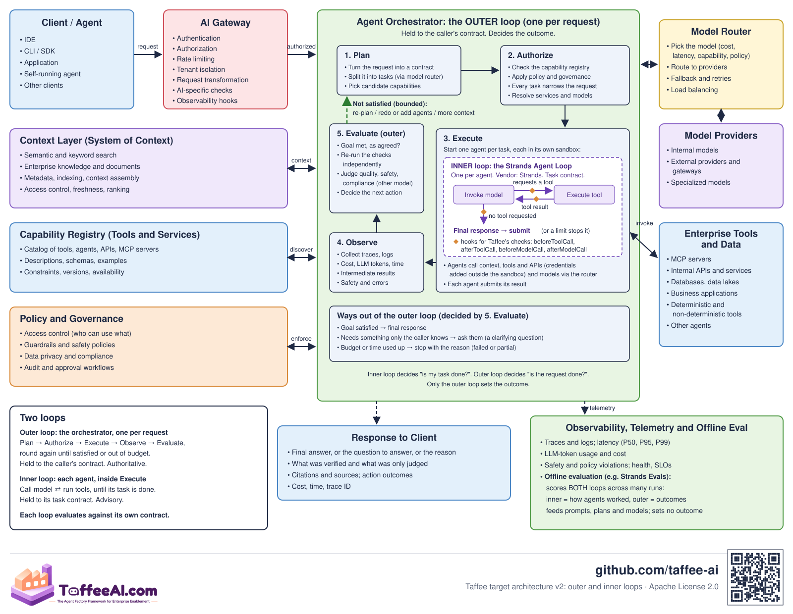
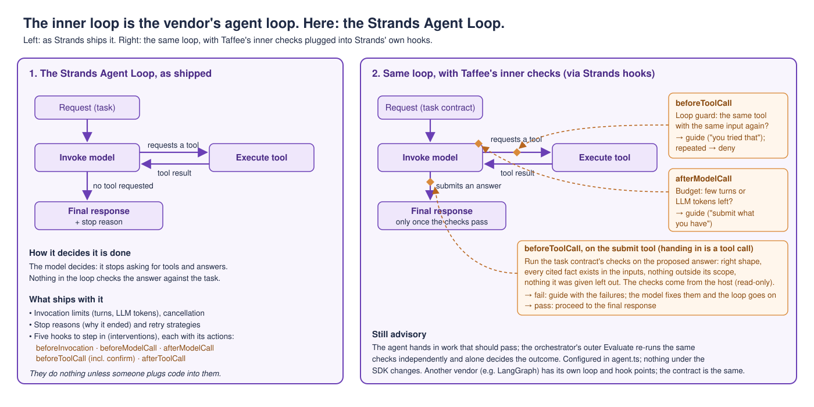

# Two loops: how the orchestrator and its agents work together

Every request to Taffee runs through **two loops, one inside the other**. Telling them apart is the key to the rest of the design. Each loop has its own job, its own contract, and its own evaluation, and most confusion about agent quality comes from mixing them up.



## The short version

- **The outer loop is the orchestrator.** There is one per request: Plan → Authorize → Execute → Observe → Evaluate, and round again until the goal is met, the caller has to be asked something, or the budget runs out. It is held to the **caller's contract** and it alone decides the outcome.
- **The inner loop is an agent.** There is one per task, and it runs **inside step 3, Execute**: call the model, run the tools it asks for, give it the results, and repeat until its task is done. It is held to **its task's contract**, and its judgement is advisory.

The inner loop answers *"is my task done?"*. The outer loop answers *"is the request done?"*.

## The inner loop: the vendor's agent loop (here, the Strands Agent Loop)

The inner loop belongs to whichever agent framework runs the agent, and is described in that framework's own terms. Taffee uses [Strands](https://github.com/strands-agents/harness-sdk); each agent runs in its own WebAssembly sandbox. Strands calls its loop the **Agent Loop**: invoke the model, check whether it wants a tool, execute the tool if so, then invoke the model again with the result; repeat until the model produces a final response.

```
prompt ─► call the model (instructions + conversation + tool list)
             │
             ├─ the model asks for tools ─► run them ─► add the results ─► call the model again
             │
             └─ the model says it's done (or a limit is reached) ─► return the result
```

- **The model drives it.** Strands carries out what the model chooses (call a tool, or stop) and keeps the conversation.
- **It stops when the model says so**, or when a limit stops it: turns, LLM tokens, time.
- **Strands has no evaluate step of its own.** It offers hooks where code can step in (interventions); Taffee's inner checks plug in there:

| Strands hook | Fires | Allowed actions | Taffee's check |
|---|---|---|---|
| `beforeInvocation` | when the agent is given a request | proceed, deny, guide, transform | — |
| `beforeModelCall` | before each model call | proceed, deny, guide, transform | — |
| `afterModelCall` | after each model reply | proceed, guide, transform | **budget**: few turns or LLM tokens left → guide ("submit what you have") |
| `beforeToolCall` | before each tool runs | proceed, deny, guide, confirm, transform | **loop guard**: the same tool with the same input again → guide, then deny |
| `beforeToolCall` on `submit` | before the answer is handed in (handing in is a tool call) | as above | **contract checks** on the proposed answer → fail: guide with the failures, and the loop goes on; pass: proceed |
| `afterToolCall` | after each tool returns | proceed, transform | — |


- **No secrets inside.** The agent's calls leave the sandbox with placeholder credentials; the host attaches the real ones per destination.

## The outer loop: the orchestrator

| Stage | What it does |
|---|---|
| **1. Plan** | Turns the request into a contract (what is wanted, what the answer looks like, what "done" means) and splits it into tasks |
| **2. Authorize** | Checks capabilities and policy; every task may only narrow the request (less budget, fewer files, no stronger effects) |
| **3. Execute** | Starts one agent per task. **This is where the inner loops run.** Each agent submits its result |
| **4. Observe** | Collects what happened: results, cost, LLM tokens, time, errors |
| **5. Evaluate** | Checks the combined result against the caller's contract and **decides the next action** |

What Evaluate can decide:

| Decision | When | Then |
|---|---|---|
| **Satisfied** | the goal is met as agreed | reply with the answer, what was verified and what was only judged, cost and trace |
| **Not satisfied** | something is missing or wrong, and budget remains | go round again: re-plan, redo or add an agent, fetch more context. The number of rounds is bounded |
| **Needs the caller** | only the caller can supply what is missing | reply with a clarifying question |
| **Out of budget or time** | the limit is reached | stop, and reply with the reason (failed, or partial if the contract allows it) |

## Each loop evaluates against its own contract

| | Inner loop (agent) | Outer loop (orchestrator) |
|---|---|---|
| **Held to** | its task's contract (the narrowed manifest) | the caller's contract (the frozen manifest) |
| **When** | after each step, and before submitting | after the agents return, and after every round |
| **Asks** | Did that tool call work? Am I making progress or going in circles? Does my answer hold against my inputs? Keep going, fix, submit, or give up? | Is the goal met? Do the agents' results cover everything and fit together? Quality, safety, compliance? Within budget? Is another round worth it? |
| **How** | mostly fast, mechanical checks offered to the agent (read-only, defined by the host), plus guards against looping and overspending | the same checks re-run independently by the host, a judge model that is **not** the one that did the work, and policy |
| **Authority** | advisory: it helps the agent hand in work that will pass | final: only it sets the outcome |

**Why not let the agent decide?** A model grading its own work is biased toward "looks good", and an agent that can see and change its checks will learn to pass the checks rather than meet the goal. So the agent gets feedback, and the orchestrator keeps the verdict. Everything both loops check traces back to the contract the caller agreed.

**A third layer sits outside both: offline evaluation.** A harness such as Strands Evals runs many varied requests against the service, including simulated multi-turn callers. It scores how agents worked (inner) and what the requests achieved (outer), across runs. It feeds better prompts, plans and model choices, and never sets an outcome.

## A worked example

> "If I rename PaymentService to PaymentGateway in payments-service, what breaks?"

1. **Plan:** the contract is to find every line that breaks, with file and line; every cited line must exist and mention the symbol; every file must be covered. The work is split into 4 tasks, one per top-level folder.
2. **Authorize:** each task gets a share of the budget and only its folder, so it narrows the request.
3. **Execute:** 4 agents run their **inner loops**, each reading its files, working out the breaks, and submitting. With an inner evaluator, an agent that cites a line that does not exist is told so and fixes it before submitting.
4. **Observe:** 12 model calls, $0.07, 35 seconds.
5. **Evaluate:** the host re-checks every citation and the coverage across all 4 agents.
   - All good: **satisfied**, so it replies.
   - One file missed: **not satisfied**, so it sends one more agent for that file, then evaluates again.
   - Out of budget: it **stops** and says why.

## What is built today

| Part | Status |
|---|---|
| Inner loop (Strands agents in sandboxes, credentials attached by the host, limits) | built |
| Outer stages 1–4 (contract, plan with narrowing checks, parallel agents, usage and records) | built; the capability registry, governance and OpenTelemetry traces are not connected yet |
| Outer Evaluate: mechanical checks against the contract | built |
| Outer Evaluate: **deciding the next action** (the "not satisfied" arrow, bounded rounds, asking the caller) | **not built**: a failed check goes straight to the reply |
| Outer Evaluate: judge model for quality, safety, compliance | not built |
| Inner evaluation (check before submitting, loop guards) through Strands interventions | not built |
| Offline evaluation harness | not built |

## How v2 differs from the original diagram

The original diagram draws a single loop whose labels mix both levels: "call more tools" is an agent's decision, while "check against the capability registry" and "goal satisfied, final response" are the orchestrator's. v2:

- draws the **inner loop inside 3. Execute**, in the vendor's own terms (the Strands Agent Loop), with the hook points where Taffee's inner checks plug in;
- relabels the "not satisfied" arrow with the orchestrator's decisions (re-plan, redo or add agents, more context), and bounds it;
- adds the outer loop's other exits: ask the caller, and stop on budget or time;
- adds offline evaluation to Observability, covering both loops;
- has the response say what was verified and what was only judged.
